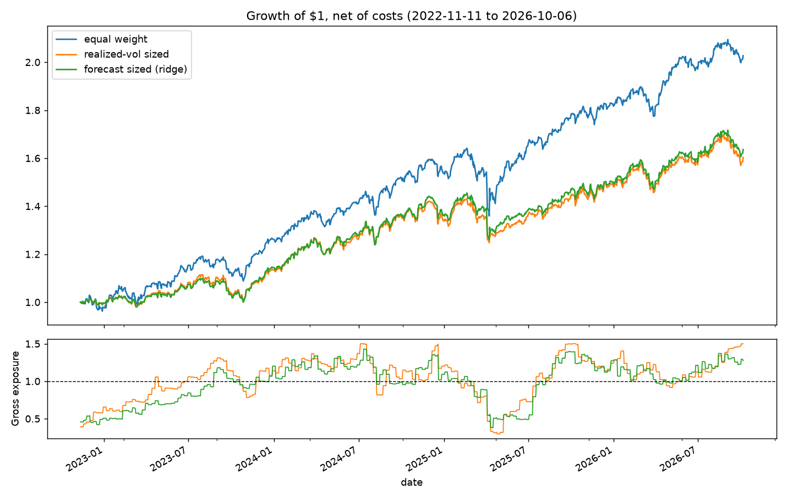
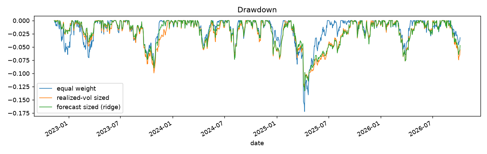

# vol-trading-system

A volatility-aware trading system. A scikit-learn model forecasts each stock's volatility,
and the forecasts size positions so the portfolio runs at a fixed risk level.

Python · pandas · scikit-learn · Alpaca API · Datadog

## Pipeline

1. **Data**: 5 years of daily prices for 50 large-cap US equities
2. **Forecast**: predict each stock's next-20-day realized vol, validated walk-forward
3. **Size**: inverse-vol weights, scaled to a 10% portfolio vol target
4. **Backtest**: compare against equal weight, net of transaction costs
5. **Trade**: paper-trade on Alpaca, monitored with Datadog

## Setup

```
python3 -m venv .venv
source .venv/bin/activate
pip install -r requirements.txt
pip install -e .
```

All settings are in `src/voltrade/config.py`.

```
python scripts/fetch_data.py     # download + cache prices
python scripts/run_forecast.py   # walk-forward vol forecasts -> reports/
python scripts/run_backtest.py   # sizing backtest -> reports/, docs/
pytest
```

## Results

### Forecasting

Target: each stock's log realized vol over the next 20 trading days. One pooled model across
all 50 stocks, scored out-of-sample over 5 expanding walk-forward folds
(Nov 2022 – Oct 2026), with a 20-day gap so training labels never overlap the test period.

| model | RMSE | MAE | QLIKE | R² vs rolling mean |
|:--|--:|--:|--:|--:|
| **ridge** | **0.338** | **0.266** | **0.275** | **0.28** |
| gradient boosting | 0.349 | 0.276 | 0.282 | 0.23 |
| rolling mean (baseline) | 0.398 | 0.311 | 0.384 | 0 |
| ewma | 0.401 | 0.312 | 0.383 | −0.01 |
| naive (last 20 days) | 0.416 | 0.324 | 0.425 | −0.09 |

Ridge cuts RMSE **15.2%** versus the rolling baseline and wins in all 5 folds. Gradient
boosting doesn't beat it: the signal is mostly linear in log vol, and the extra flexibility
fits noise.

### Sizing backtest

Out-of-sample only (Nov 2022 – Oct 2026), weekly rebalance, 5 bp costs, 10% vol target,
1.5x gross cap. Weights drift between rebalances.



| strategy | Ann. ret | Ann. vol | Sharpe | MaxDD | Avg exposure | Ann. turnover |
|:--|--:|--:|--:|--:|--:|--:|
| equal weight | 20.0% | 13.1% | **1.46** | −17.2% | 1.00 | 1.6x |
| realized-vol sized | 12.9% | 11.2% | 1.15 | **−12.8%** | 1.05 | 7.7x |
| forecast sized (ridge) | 13.5% | 10.9% | 1.23 | −13.3% | 0.99 | 5.7x |



What this shows:

- **The forecast beats trailing vol for sizing.** Same rule, better input: Sharpe 1.23 vs 1.15,
  realized vol closer to the 10% target, and 25% less turnover because forecasts are smoother.
- **Vol targeting cuts drawdown** from −17.2% to about −13%. In the April 2025 selloff,
  exposure dropped to 0.3–0.4x.
- **Equal weight still has the best Sharpe over this window.** Inverse-vol sizing underweights
  the most volatile names, and 2023–2026 was led by exactly those (NVDA, AVGO, META, TSLA).
  Vol sizing also sat at ~0.5x exposure through the early-2023 recovery while trailing vol
  was still elevated. This is one bull-market window; it isn't evidence that equal weight
  dominates in general, and it's reported as-is rather than tuned away.

Caveats: the universe is 50 stocks that are large *today* (survivorship bias), costs are a
flat 5 bp, and there is only ~4 years of out-of-sample data.
